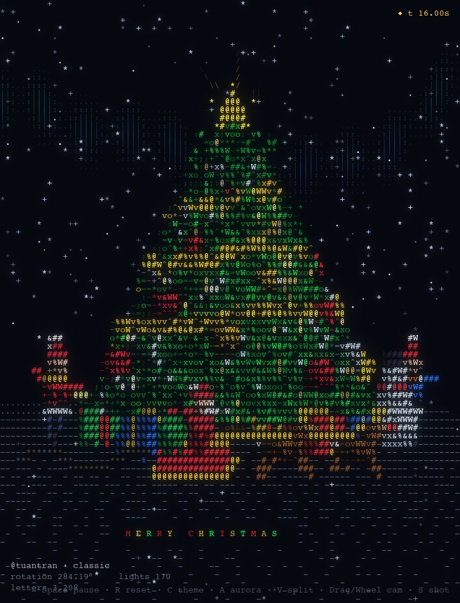
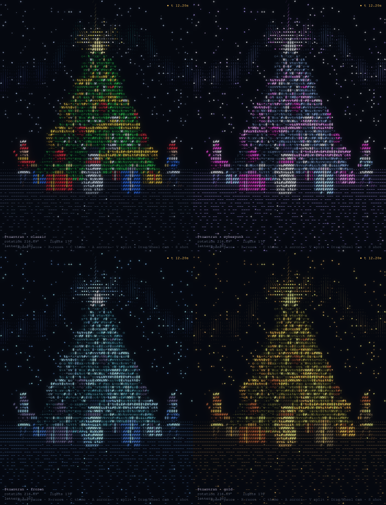
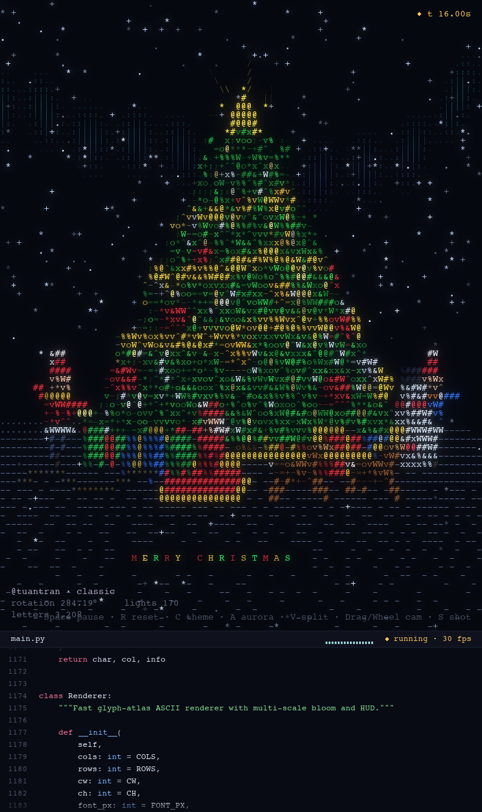

# ASCII Christmas Tree & Split-Screen Reel Generator (Single-File Edition)

All-in-one Python script ([main.py](main.py)) combining an interactive 3D ASCII Christmas Tree window (`pygame` + `numpy` + `opencv`), a procedural 80s synth-pop / music-box soundtrack generator, and a vertical 9:16 split-screen MP4 Reel exporter (`1080×1920 @ 30fps`) with live scrolling syntax-highlighted source code.

## Preview

| 3D ASCII Scene (Santa, Walkers & Aurora) | 4 Color Palettes (`classic`, `cyberpunk`, `frozen`, `gold`) |
| :---: | :---: |
|  |  |

<p align="center">
  
</p>

## Features

- **3D Point-Cloud ASCII Engine**:
  - 25 whorls of drooping pine branches dusted with snow tips and dark inner-cone occlusion.
  - Textured bark trunk, 3.6-turn golden tinsel swags, 34 red/gold/silver baubles, and 170 twinkling branch-tip fairy lights.
  - 6 wrapped 3D gift boxes with crossed ribbons and bow loops orbiting around the base, plus a **3D Snowman** (with red scarf, carrot nose, and top hat).
  - **Animated 3D Winter Walkers & Santa's Reindeer Sleigh**: Two winter characters walk in from both sides holding glowing lanterns and wave at the tree, while **Santa Claus and his galloping reindeer (led by Rudolph)** dash across the snowy foreground trailing magic stardust.
  - 5-pointed glowing top star with 8-way rays that bursts white at `t = 11.8s` and launches **240 3D starburst firework sparkles** around the canopy.
  - Shimmering **Aurora Borealis** curtains, twinkling starry sky, falling snowflakes, perspective ground grid, multi-scale additive bloom, and typed holiday greeting (`M E R R Y   C H R I S T M A S   2 0 2 6`).
  - **4 Color Palettes**: Switch instantly between `classic`, `cyberpunk`, `frozen`, and `gold`.
- **Audio-Reactive Visuals & Custom Track Support**:
  - Built-in procedural 80s synth-pop & chime cover of _"Last Christmas"_ (`D → Bm → Em → A` at `108 BPM`, default) or traditional carol (`--theme traditional`), or any custom audio/video file via `--audio` + `--audio-start`.
  - **Real-time 60Hz FFT Audio Analyzer**: Fairy lights, tinsel, top star, bloom intensity, and a **16-bar live spectrum visualizer** pulse in sync with the bass and melody.
- **Interactive 3D Camera & Live Split-Screen (`--split` / `--export`)**:
  - Orbit and tilt the 3D camera by dragging with the mouse, or zoom in/out with the scroll wheel.
  - Toggle live split-screen mode (`V` key or `--split`) to watch the syntax-highlighted source code scroll in sync with the animation and live equalizer header, or export a `1080×1920 @ 30fps` MP4 Reel via `--export`.

## Setup

```powershell
python -m venv .venv
.\.venv\Scripts\activate
pip install -r requirements.txt
```

## Usage

### 1. Run Interactive ASCII Window (with audio)

```powershell
python christmas_tree.py
```

With a custom music track starting at `18.0s`:

```powershell
python christmas_tree.py --audio path\to\last_christmas.mp3 --audio-start 18.0
```

Controls:

- `Space`: Pause / Resume (video & audio)
- `R`: Restart choreography & reset 3D camera
- `C`: Cycle color theme (`classic` → `cyberpunk` → `frozen` → `gold`)
- `A`: Toggle Aurora Borealis northern lights
- `V`: Toggle live Split-Screen code + spectrum visualizer pane
- `Mouse Drag` / `Scroll Wheel`: Orbit / tilt 3D camera & zoom in/out
- `Left` / `Right`: Scrub `-1s` / `+1s`
- `S`: Save screenshot into `output/`
- `Esc` / `Q`: Quit

### 2. Export Vertical Split-Screen Reel Video

```powershell
python christmas_tree.py --export output/christmas_tree_reel.mp4
```

Options:

- `--export [MP4]`: Export 9:16 MP4 Reel (defaults to `output/christmas_tree_reel.mp4`)
- `--res 1080p|720p`: Output resolution (`1080×1920` or `720×1280`, default `1080p`)
- `--fps 30`: Frame rate (default `30`)
- `--duration 20`: Reel duration in seconds (default `20.0`)
- `--author "@your.handle"`: Bottom-left signature handle
- `--message "M E R R Y   C H R I S T M A S   2 0 2 6"`: Greeting text
- `--audio path/to/song.mp3`: Custom music/video file (`.mp3`, `.m4a`, `.wav`, `.mp4`, etc.)
- `--audio-start 0.0`: Start offset in seconds when using `--audio`
- `--theme last_christmas|traditional`: Built-in synthesized soundtrack (`last_christmas` default)
- `--no-audio`: Disable audio playback or export silent MP4

### 3. Run Tests

```powershell
python -m unittest discover -s tests -v
```
